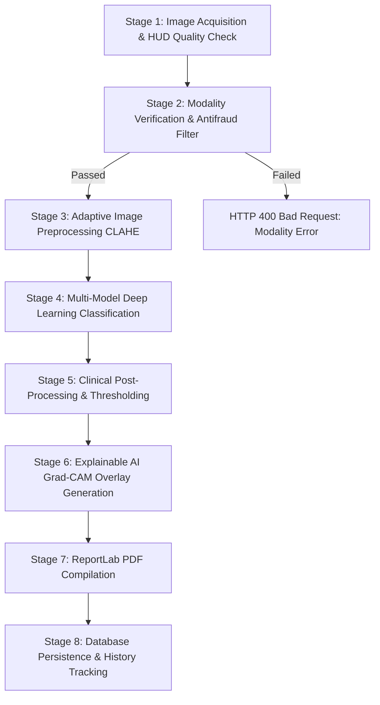
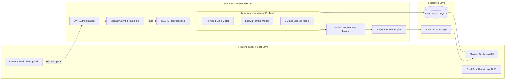

# ScalpDiagnostix AI: Technical Stack, Methodology & Architecture

This document provides a comprehensive technical overview of the **ScalpDiagnostix AI** system, covering the full-stack technologies, the multi-stage machine learning methodology, and the end-to-end system architecture.

---

## 1. Technology Stack

The platform is designed as a decoupled, full-stack medical diagnostics web application with deep learning inference capabilities.

```
+-----------------------------------------------------------------------------------+
|                                  TECHNOLOGY STACK                                 |
+-----------------------------------------------------------------------------------+
| Layer               | Technology Used               | Purpose                     |
+---------------------+-------------------------------+-----------------------------+
| Frontend Client     | React 18, TypeScript, Vite    | Responsive SPA, Clinical HUD|
| Styling & UI        | Tailwind CSS, Lucide Icons    | Modern Medical Dashboard UI |
| State & Routing     | React Router v6, Context API  | Language (i18n), Auth State |
| Backend API Engine  | FastAPI (Python 3.10), Uvicorn| High-Performance REST API   |
| Database Layer      | SQLAlchemy ORM, SQLite / PG   | Scan logs, Users, History   |
| Deep Learning / AI  | PyTorch, Torchvision          | Neural Network Classifiers  |
| Model Architecture  | EfficientNet-B0 (Transfer)    | Feature Extraction & Head   |
| Computer Vision     | OpenCV (cv2), PIL, NumPy      | Preprocessing & Validation  |
| Explainability (XAI)| Grad-CAM (Target Layer Hooks) | Visual Heatmap Overlays     |
| Report Generation   | ReportLab (Python)            | Dynamic Clinical PDF Reports|
| Containerization    | Docker, Docker-Compose        | Unified Cloud/Local Deploy  |
+---------------------+-------------------------------+-----------------------------+
```

### Detailed Component Inventory:

### Frontend
* **Core Framework**: React 18 with TypeScript for type-safe clinical data representation.
* **Build Engine**: Vite for fast bundling and hot module replacement.
* **Webcam & Image Capture**: HTML5 `MediaDevices.getUserMedia` API, custom Canvas-based luminance/blur evaluation (60 FPS HUD), and `ImageCapture` API integration.
* **Design & Icons**: Tailwind CSS utility design system with glassmorphism overlays and Lucide-React medical icon set.
* **Internationalization**: React Context-driven i18n system for multi-language clinical translation.

### Backend
* **API Framework**: FastAPI with Python 3.10, utilizing async request handling and Pydantic schema validation.
* **Authentication**: OAuth2 password flow with JWT bearer tokens and Bcrypt password hashing.
* **Database & ORM**: SQLAlchemy ORM with an automatic dual-engine architecture:
  * Primary: PostgreSQL (production docker instances).
  * Auto-Fallback: Local SQLite file database (`scalp_analysis.db`) when external servers are unavailable.
* **PDF Compilation**: ReportLab library compiling customized clinical PDF diagnostic summaries with doctor signatures, visual thumbnails, and metrics.

### AI, Machine Learning & Computer Vision
* **Deep Learning Engine**: PyTorch & Torchvision (CPU optimized build for lightweight deployment).
* **Pretrained Base**: ImageNet-pretrained `EfficientNet-B0` with unfrozen convolutional backbones.
* **Computer Vision Tools**: OpenCV for adaptive histogram equalization (CLAHE), HSV color-space transformation, Canny edge detection, and geometric contour analysis.
* **Explainable AI (XAI)**: Grad-CAM implementation hooking into `model.features[-1]` to extract forward activations and backward gradients for heatmap generation.

---

## 2. System Methodology

The diagnostic methodology operates as an 8-stage pipeline from image acquisition to clinical reporting:



### Stage 1: Image Acquisition & Quality Assessment
* **Live Camera Feed**: The client's webcam is monitored at 60 FPS using an in-memory Canvas.
* **Quality Check**:
  * **Luminance**: Converts frames to YUV color-space and calculates mean Y-channel brightness. Flagged if brightness $< 50$ (Low Light) or $> 215$ (Glare).
  * **Blur Detection**: Calculates the Laplacian variance $\sigma^2 = \text{Var}(\nabla^2 I)$. Flagged if blur score $< 75$.
* **Capture Trigger**: 3-second countdown timer snaps high-resolution image via `ImageCapture` or video fallback.

### Stage 2: Modality Verification & Non-Scalp Filter
To prevent random objects (e.g. slides, documents, product packaging) from being misclassified:
1. **White Background Check**: Rejects images where $>30\%$ of pixels are near-white (`BGR > 235`), identifying slides and documents.
2. **Text / Printed Pattern Detector**: Analyzes a $1000 \times 1000$ high-resolution central crop using adaptive thresholding and contour analysis. If $>30$ boxy, letter-like contours ($\text{Area} \ge 70\text{px}$, $\text{Solidity} > 0.35$, $\text{Aspect Ratio} \in [0.2, 5.0]$) are detected, it is rejected as commercial packaging or a barcode label. Hair stubble is filtered out because individual stubble dots have an area $< 70\text{px}$.
3. **Skin/Hair Color Density**: Converts image to HSV space and verifies that $\ge 8\%$ of the image matches human skin/hair tones ($\text{Hue} \in [0, 25] \cup [165, 180]$, $\text{Sat} \in [20, 150]$, $\text{Val} \ge 50$).

### Stage 3: Adaptive Computer Vision Preprocessing
* **Contrast Enhancement**: Applies Contrast Limited Adaptive Histogram Equalization (**CLAHE**) on the Y-channel in YUV space (`clipLimit=2.0`, `tileGridSize=(8,8)`). This highlights individual follicle shafts and boundary contrast.
* **PyTorch Normalization**: Resizes image to $224 \times 224$, converts to RGB tensor, and normalizes using standard ImageNet parameters ($\mu = [0.485, 0.456, 0.406]$, $\sigma = [0.229, 0.224, 0.225]$).

### Stage 4: Multi-Model Deep Learning Classification
The backend runs inference through gender-specific and condition-specific neural networks:

1. **Male Pattern Hair Loss Model (Norwood Scale)**:
   * **Classes**: 7 stages (`Stage 1` to `Stage 7`).
   * **Backbone**: `EfficientNet-B0` with fine-tuned convolutional weights.
2. **Female Pattern Hair Loss Model (Ludwig Scale)**:
   * **Classes**: 3 stages (`Ludwig Stage I`, `Ludwig Stage II`, `Ludwig Stage III`).
   * **Backbone**: `EfficientNet-B0` trained with offline geometric augmentations.
3. **Scalp Disease Multi-Class Model**:
   * **Classes**: 9 classes (8 diseases + 1 healthy class):
     * *Acne Keloidalis, Alopecia Areata, Androgenic Alopecia, Dissecting Cellulitis, Folliculitis Decalvans, Healthy Scalp, Pseudopelade, Trichotillomania, Tufted Folliculitis*.
   * **Training Technique**: Inverse-class-frequency weighted Cross-Entropy loss ($\approx 12\times$ higher penalty for minority classes like *Alopecia Areata*), classifier dropout ($p=0.4$), L2 weight decay ($10^{-3}$), and early stopping on minimum validation loss.

### Stage 5: Post-Processing & Differential Diagnostics
* **Cumulative Probability Thresholding**: Norwood severe stages (5, 6, 7) require cumulative probability $\ge 45\%$ to prevent false alarms on healthy heads.
* **Scalp Disease Confidence Threshold**: Dynamic threshold of $30\%$ for custom 9-class models ($85\%$ for fallback models) before defaulting to `Healthy Scalp`.
* **Differential Diagnostic Guidance**: Because *Alopecia Areata* (autoimmune) and *Trichotillomania* (hair-pulling) share visual overlap, the system outputs explicit clinical differential guidance (e.g. prompt to inspect borders for exclamation-mark hairs vs broken shafts of varying lengths).

### Stage 6: Explainable AI (Grad-CAM Heatmap Generation)
* Forward hooks capture activations from the final convolutional layer: `model.features[-1]`.
* Backward hooks calculate gradients of the predicted class score $y^c$ with respect to feature maps $A^k$.
* Importance weights $\alpha_k^c = \frac{1}{Z} \sum_{i} \sum_{j} \frac{\partial y^c}{\partial A_{i,j}^k}$ are computed and combined:
  $$L_{\text{Grad-CAM}}^c = \text{ReLU}\left(\sum_k \alpha_k^c A^k\right)$$
* The resulting heatmap is upsampled to original image dimensions, colormapped using `COLORMAP_JET`, and blended with the scan image at a $60\% / 40\%$ transparent ratio.

### Stage 7: PDF Compilation & Medical Reporting
* Compiles a clinical report using ReportLab with:
  * Patient metadata & clinic header.
  * Side-by-side scan thumbnail and Grad-CAM activation overlay.
  * Quantitative metrics (Lighting, Blur score, Classification Confidence).
  * AI explanations and actionable clinical recommendations.
  * Editable Doctor / Practitioner comments block and signature line.

### Stage 8: Database Persistence & History Tracking
* Records are stored via SQLAlchemy ORM with foreign key links to the clinician user.
* All scans are evaluated independently (zero cross-scan session state leakage).

---

## 3. System Architecture & Component Interactions



---

## 4. Deployment Architecture

The application supports multiple deployment topologies:

1. **Unified Docker Container (Free Cloud - Hugging Face Spaces)**:
   * Multi-stage build compiling React into static assets.
   * FastAPI mounts `frontend_dist` and serves both the API endpoints (`/api/...`) and the Single Page Application (`/`) on port `7860`.
2. **Local Clinic Network (On-Premise)**:
   * Workstation server running FastAPI + PyTorch backend.
   * Local Nginx reverse proxy providing SSL (HTTPS) termination to allow local iPads/tablets to access webcams across local Wi-Fi.
